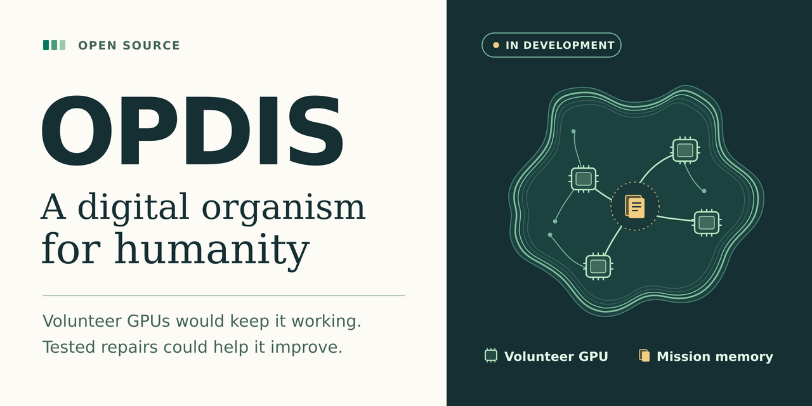

# Share OPDIS

## Short introduction

OPDIS is an open-source effort to build one continuous digital organism from volunteer GPUs. People would install a client and lend their computers for as long as they choose. The organism would keep working on public missions as machines come and go, repair its own tools and share verified advances freely. A working prototype can already distribute questions to trusted workers. The volunteer client is a development goal.

## Community announcement

Imagine your computer spending tonight on a neglected health problem. It could check a handful of public studies and record a contradiction. When you disconnect in the morning, someone else’s machine could pick up that question. A year later, the community could see which leads held up, which repairs made its tools better and what to investigate next.

That is the vision for OPDIS, the Open Distribution Intelligence System. Volunteers would choose when to lend a GPU, communities would choose missions, and people without hardware or subscriptions could use the results for free. The larger aim is freedom from oppressive systems and dependencies, including a future in which nobody has to work to survive. Part of the research is whether an organism that can diagnose faults, verify repairs and then improve its own methods could progress exponentially toward superintelligence.

Today the software can assign a batch of questions to trusted workers and compare a proposed instruction against the old one. All eight automated tests passed, and two simulated workers shared a job. Contributors can help run the first two-GPU benchmark, build a record that keeps a mission alive across restarts, or write tests that catch a bad repair.

[Read the white paper](OPDIS-White-Paper.pdf) · [Find a contribution](../PROJECT_PROGRESS.md)

## Repository description

Open-source research toward a free digital organism powered by volunteer GPUs, with persistent public missions and the ability to verify and build on its own repairs.

## Sharing image

Share the image with the short introduction or community announcement.
